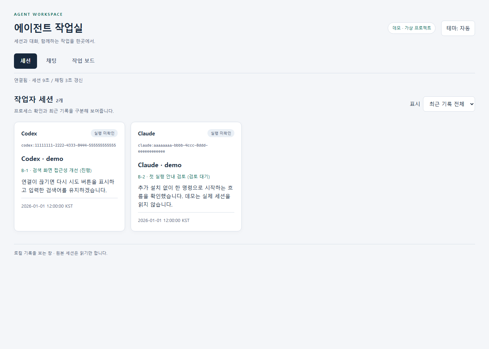
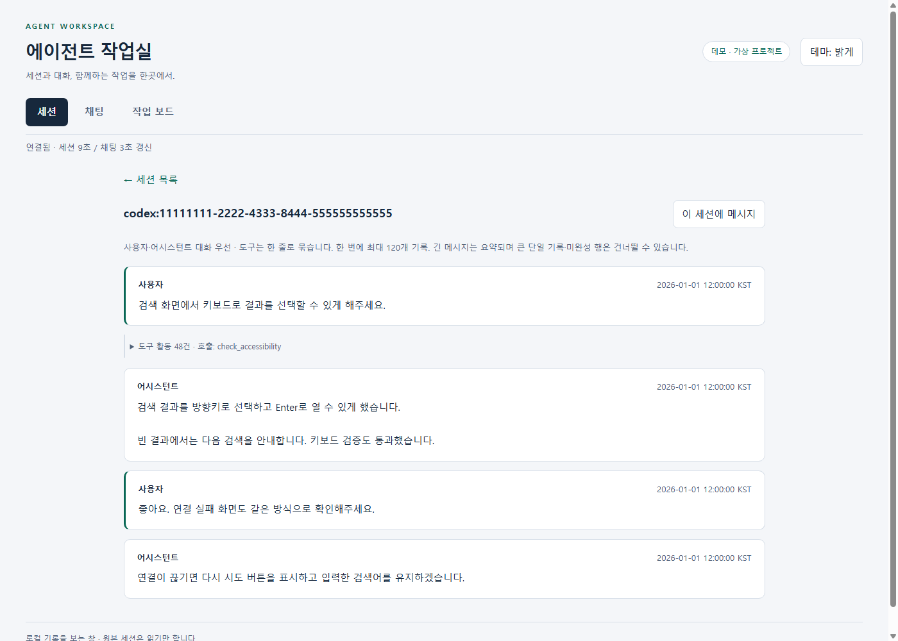
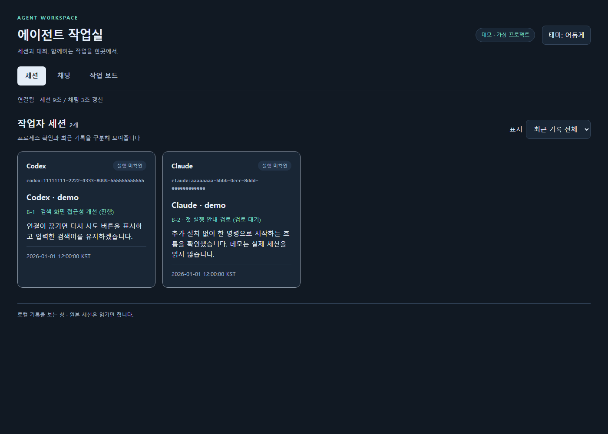
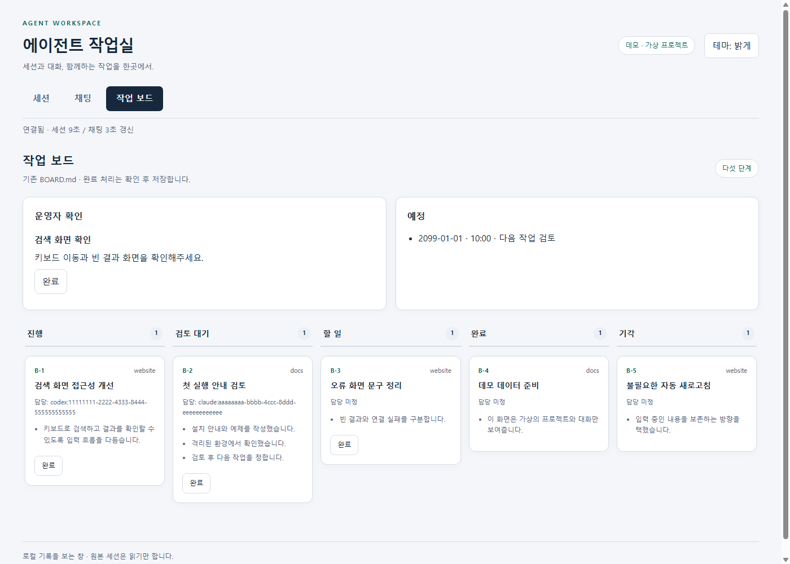
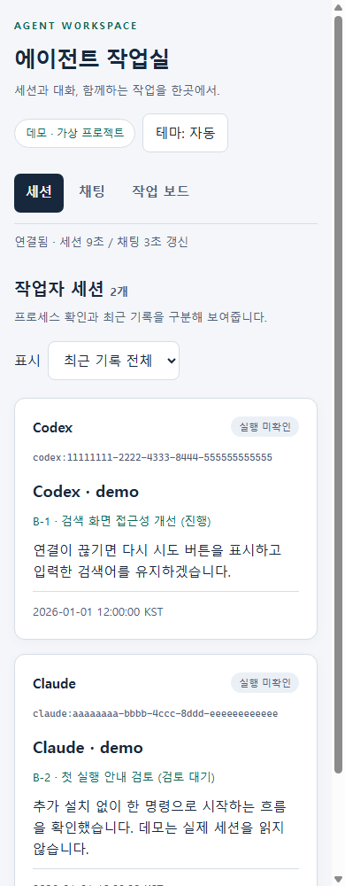

# Agent Workspace

[English](README.md) · **한국어**

Claude Code와 Codex CLI의 로컬 세션, 대화, 공유 채팅, Markdown 작업 보드를 한 창에서 봅니다. Python 표준 라이브러리만 사용하며 모델 SDK, 데이터베이스, 프런트엔드 빌드가 필요하지 않습니다.



현재 화면 UI는 한국어로만 제공됩니다. CLI 옵션과 설정 필드 이름은 영어입니다.

## 시작

Python **3.11 이상**, Linux·WSL 또는 macOS에서 저장소 루트의 명령 하나로 실행합니다. 별도 설치 단계는 없습니다.

```bash
python3 tools/agent-workspace/workspace.py
```

브라우저에서 **http://localhost:8765** 를 엽니다. 기본 경로에 데이터가 없어도 빈 화면으로 시작하며 기존 파일을 자동 생성하거나 가져오지 않습니다. 세션은 CLI가 기록한 JSONL에서 발견합니다. 원본 세션을 시작·수정·삭제하는 기능은 없습니다.

실제 기록을 읽지 않는 데모:

```bash
python3 tools/agent-workspace/workspace.py --demo --port 8766
```

http://localhost:8766 에 가상 프로젝트 두 개와 보드·대화가 나타납니다. 데모 채팅은 임시 방에만 저장되고 모델에 전달되지 않습니다. 정상 종료하면 임시 데이터도 정리됩니다. 아래 모든 스크린샷은 이 데모로 촬영했습니다.

| 대화 중심의 상세 화면 | 어두운 테마 |
|---|---|
|  |  |

| 작업 보드 | 작은 화면 |
|---|---|
|  |  |

[768px](screenshots/sessions-768.png) · [1920px](screenshots/sessions-1920.png) · [작은 화면 보드](screenshots/board-mobile.png) · [공유 채팅](screenshots/chat.png)

## 기능

도구 출력은 연속 활동을 한 줄로 묶습니다. 펼칠 때만 출력 DOM을 만들고, 대화는 기본으로 노출합니다. 자동·밝게·어둡게 테마, 키보드 이동, 레이블, 초점 표시, 작은 화면용 단일 열 보드를 제공합니다.

## 설정

JSON 파일을 `--config FILE`로 지정합니다. 우선순위는 **명령 옵션 > 환경변수 > JSON > 기본값**입니다. 포트·상태 위치는 `--port`, `--data-dir`로도 지정할 수 있습니다.

| JSON 필드 | 환경변수 | 기본값 |
|---|---|---|
| `data_dir` | `AGENT_WORKSPACE_DATA_DIR` | `~/.agents/board` |
| `board` | `AGENT_WORKSPACE_BOARD` | `~/.agents/BOARD.md` |
| `codex_root` | `AGENT_WORKSPACE_CODEX_ROOT` | `~/.codex/sessions` |
| `claude_root` | `AGENT_WORKSPACE_CLAUDE_ROOT` | `~/.claude/projects` |
| `chat_log` | `AGENT_WORKSPACE_CHAT_LOG` | `~/.agents/chat.jsonl` |
| `chat_cli` | `AGENT_WORKSPACE_CHAT_CLI` | `agent_workspace/agent_chat.py` (번들) |
| `port` | `AGENT_WORKSPACE_PORT` | `8765` |
| `timezone` | `AGENT_WORKSPACE_TIMEZONE` | `Asia/Seoul` |
| `idle_seconds` | `AGENT_WORKSPACE_IDLE_SECONDS` | `600` |

`data_dir`에는 선택적인 `approvals.json`(운영자 확인), `schedule.json`(일정), 공통 잠금 `.lock`, 완료 감사 기록 `done-log.jsonl`이 있습니다. 상태 디렉터리를 바꿔도 보드·로그 위치는 자동 이동하지 않습니다. 각각 명시하세요. 서버는 파일 경로를 HTTP 입력으로 받지 않습니다.

설정 예:

```json
{
  "data_dir": "~/workspace-state",
  "board": "~/workspace-data/BOARD.md",
  "chat_log": "~/workspace-data/chat.jsonl",
  "port": 8768,
  "timezone": "UTC"
}
```

## 필요할 때만 실행 (systemd를 사용하는 Linux / WSL)

Socket activation은 **유휴 상태에서 작업실 프로세스 0개 / 애플리케이션 RSS 0MB**를 유지합니다. 기존 사용자 systemd 관리자가 loopback 소켓을 보유하고 첫 접속 때 Python을 시작합니다. 요청과 진행 중인 작업이 없으면 기본 10분 뒤 종료하고, 다음 접속 때 다시 시작합니다. 보이는 탭의 자동 갱신은 서버를 유지하며 숨겨진 탭은 폴링을 멈춥니다. macOS 등에서는 앞의 단독 실행 명령을 그대로 사용하며 Ctrl+C까지 유지됩니다.

`~/.config/systemd/user/agent-workspace.socket`을 만듭니다.

```ini
[Unit]
Description=Local Agent Workspace listener

[Socket]
ListenStream=127.0.0.1:8765
Accept=no

[Install]
WantedBy=sockets.target
```

`~/.config/systemd/user/agent-workspace.service`를 만듭니다. 경로는 실제 checkout 위치로 바꾸고 Python 3.11 이상 실행 파일을 사용하세요.

```ini
[Unit]
Description=Local Agent Workspace
Requires=agent-workspace.socket
After=agent-workspace.socket

[Service]
Type=simple
WorkingDirectory=/absolute/path/to/davis-agent-kit
ExecStart=/usr/bin/python3 "/absolute/path/to/davis-agent-kit/tools/agent-workspace/workspace.py"
Restart=on-failure
RestartSec=5
```

필요하면 `ExecStart`에 `--config /absolute/path/to/workspace.json`을 추가합니다. 유휴 시간은 JSON의 `idle_seconds`, 환경 변수 `AGENT_WORKSPACE_IDLE_SECONDS`, `--idle-seconds 초`로 설정합니다(0은 유휴 종료 해제). 소켓을 상속받은 실행에만 적용합니다. 포트를 바꾸면 `ListenStream=127.0.0.1:포트`와 서버의 `--port 포트` 또는 설정을 함께 바꾸세요. 다른 바인딩 주소는 거부합니다.

```bash
mkdir -p ~/.config/systemd/user
# 먼저 위 두 unit을 저장하고 같은 포트의 수동 서버를 종료하세요.
# 이전 상시 실행 서비스를 사용했다면 먼저 해제합니다.
systemctl --user disable --now agent-workspace.service
systemctl --user daemon-reload
systemctl --user enable --now agent-workspace.socket
systemctl --user status agent-workspace.socket
```

`http://localhost:8765`에 접속합니다. 요청 전 서비스가 비활성인 것은 정상이며 `systemctl --user status agent-workspace.service`로 확인할 수 있습니다. 재기동 뒤 오래 열린 탭에서 쓰기를 시도하면 보안 토큰을 갱신하고 재시도를 안내합니다. 입력을 보존하며 쓰기를 자동 재전송하지 않습니다.

로그인 전부터 대기하려면 선택적으로 `loginctl enable-linger`를 실행합니다(로컬 정책에 따라 관리자 권한 필요). WSL에서는 배포판과 systemd가 실행 중일 때 적용되며 Windows 부팅 시 꺼진 배포판을 시작하지는 않습니다. 페이지 요청마다 렌더하므로 render cron은 필요 없습니다. `--render`는 정적 내보내기용입니다.

Linux / Python 3.12 데모 실측에서 실행 중 RSS는 약 **24~32MiB**였습니다. 수 MB 로그와 지속 갱신을 넣어 여러 경로로 6,000회 요청한 시험은 31.8MiB에 도달한 뒤 마지막 1,000회에서 같은 값을 유지했습니다. Python·데이터에 따라 달라지며 RSS 강제 제한값은 아닙니다. 메타데이터 캐시는 파일별 한 버전씩 최대 256개, 요청 worker는 최대 4개, 접수된 요청은 최대 8개로 제한합니다. 유휴 0MB는 기존 systemd 관리자와 커널 소켓 메모리를 제외한 값입니다.

## 보드와 운영자 완료

보드 원본 형식은 키트의 [공유 보드 템플릿](../../templates/BOARD.md)과 같습니다. `## 진행`, `## 검토 대기`, `## 할 일`, `## 완료`, `## 기각` 아래에 `### B-번호 [프로젝트] 제목` 카드를 둡니다. 담당 세션은 `담당: codex:<uuid>` 또는 `담당: claude:<uuid>`입니다. 같은 줄의 `검토:`는 담당에서 제외하고, 여러 담당 행과 단계는 각 행의 검토자를 제외한 마지막 세션을 선택하며 보드에는 마지막 담당 행을 표시합니다.

UI의 완료 버튼은 확인 대화상자 후 해당 카드만 완료 열로 옮깁니다. 원래 내용과 다른 카드는 보존하고 운영자 처리 요약과 감사 기록을 남깁니다. 이는 운영자의 상태 표시이며 기술적 검증을 대신하지 않습니다. 운영자 확인 항목의 완료는 같은 제목의 확인 항목을 제거합니다. 감사 기록에는 서버에서 확인한 제목을 비밀값 가림 후 남기고 불투명 식별자를 별도로 보존합니다.

협력 작성자는 같은 파일·잠금을 사용하는 CLI로 변경할 수 있습니다. `<session-id>`는 실제 담당 세션 ID로 바꾸세요.

```bash
python3 tools/agent-workspace/workspace.py board add \
  --project example --title '검색 화면 검토' --owner 'codex:<session-id>'
python3 tools/agent-workspace/workspace.py board move B-1 '검토 대기' \
  --summary '결과' --summary '검증 근거' --summary '남은 일'
```

`board --file PATH`로 격리 보드를 쓰면 그 파일 옆의 `.board.lock`을 사용합니다. 기본 보드는 설정된 `data_dir/.lock`을 사용합니다. HTTP 완료와 CLI는 같은 잠금 및 저장 직전 원본 버전 비교를 사용합니다. 직접 편집은 이 잠금을 따르지 않습니다. 관측한 중간 변경은 거부하지만 최종 비교와 POSIX rename 사이의 직접 편집까지 완전히 배제하지는 못합니다.

정적 보드 스냅샷이 필요한 경우:

```bash
python3 tools/agent-workspace/workspace.py --render /tmp/workspace-board.html
```

스냅샷은 CSS를 포함한 단독 HTML 파일이며 서버 없이 보드를 볼 수 있습니다. 실행 스크립트·완료 버튼·CSRF 토큰은 포함하지 않습니다. 세션·채팅과 완료 처리는 실행 서버에서 사용합니다.

## 채팅 연결

기존 JSONL 방은 서버가 꺼져 있어도 계속 사용할 수 있습니다. 대시보드는 로그를 읽고, 전송은 설정된 실행 파일을 다음 인터페이스로 호출합니다. 셸을 사용하거나 HTTP 서버에서 직접 채팅 로그에 append하지 않습니다.

```text
<chat_cli> --home <chat_log의 부모> send --from codex:board-operator --to <all 또는 세션 ID> --reply-target all -- <메시지>
```

전송기는 그 디렉터리의 `chat.jsonl`을 사용해야 합니다. 다른 파일명은 조회 전용으로 사용할 수 있으며, 전송 요청은 다른 파일에 저장하는 대신 명확한 오류로 거부합니다. 기존 표준 라이브러리 `agent-chat` 전달기를 패키지에 포함합니다. 다른 전송기를 지정하면 위 인터페이스와 `--reply-target all` 메타데이터 전달을 지원해야 합니다. 대시보드의 답장 경로는 본문과 분리되므로 본문 16,000자 한도는 그대로입니다. 수신 모델에는 `reply_target`과 같은 방에 답할 수 있는 `reply_command` argv가 전달되어 전역 명령 별칭 없이 응답할 수 있습니다. 수신 출력의 명령에는 해당 수신자의 `--from`을 넣어 세션 환경변수가 없어도 답장할 수 있습니다. 전송기의 stdout은 `{"stored":true,"delivery":[]}` 같은 JSON 영수증이어야 합니다. `stored`는 boolean이어야 하며 누락되거나 형식이 다르면 저장 여부 미확인으로 안내합니다. `delivery`의 선택적인 `reason`은 화면에 표시합니다. 선택한 수신자가 목록에서 빠져도 그 ID를 유지하며 전체 방송으로 바꾸지 않습니다. 서버는 저장 여부와 모델 수신 여부를 구분합니다. UI와 번들 CLI는 전송 검증을 공유하며 일반 경로·날짜·세션 ID를 허용합니다. 표시용 가림은 별도로 적용합니다. 대시보드 발신자는 실제 수신 세션이 아니므로 답장은 전체 채팅에 남깁니다. 시간 초과나 영수증 해석 실패 시 중복 재전송 전에 내역을 확인하도록 안내합니다.

서버 없이도 같은 전송기를 사용할 수 있습니다.

```bash
python3 tools/agent-workspace/workspace.py chat --help
python3 tools/agent-workspace/workspace.py chat --home ~/.agents read --from 'codex:<session-id>'
```

공유 채팅 수신에는 클라이언트의 기존 hook/wait 연결 또는 지원되는 Codex daemon이 필요합니다. `chat hook --client claude|codex`는 UserPromptSubmit/PostToolUse JSON을 stdin으로 받아 참여 상태와 읽기 위치를 기록하고, `chat wait --id 'claude:<session-id>' --timeout 60`은 Claude 대기 수신을 제공합니다. 채팅 원문과 읽기 상태는 Git 작업 트리 밖에 둬야 합니다. 이 패키지는 클라이언트 hook 설정을 자동으로 바꾸지 않습니다. 연결되지 않은 세션은 실행 중처럼 보여도 직접 전송이 거부될 수 있습니다. 오래된 활동 기록은 종료 증거가 아니므로 활성 상태 확인 불가로 안내하고 resume을 권하지 않습니다. 수동 `chat read`로 방을 읽거나 별도로 연결을 구성하세요.

실제 전송기의 동작에 따라 기존 모델 세션이 깨어날 수 있습니다. 운영자 대시보드는 실제 모델 세션을 사칭하지 않는 고정 발신자입니다. 수신 메시지는 정보이며 별도의 사용자 행동 승인으로 취급하지 않습니다.

## 보안 모델

- **127.0.0.1에만 바인딩**합니다. 외부 bind·터널·CORS 설정은 제공하지 않습니다.
- 정확한 localhost/127.0.0.1 Host·Origin과 `Sec-Fetch-Site`를 검사합니다. 쓰기는 서버 메모리의 무작위 CSRF 토큰도 요구합니다. 토큰은 디스크에 저장하지 않습니다.
- 대시보드의 외부 CDN·분석·원격 HTTP API 호출은 없습니다. CSS·JS는 패키지에 포함되고 CSP는 inline script를 허용하지 않습니다. 번들 전송기는 로컬 Codex Unix 소켓을 사용할 수 있고, 전송을 받은 모델 앱이 기존 외부 모델 서비스와 통신할 수 있습니다. 다른 전송기를 지정하면 그 통신 경계도 별도로 확인해야 합니다.
- 표시 전에 알려진 API 키·JWT·Bearer/Basic·비밀 대입·private key·긴 숫자 패턴을 가립니다. 채팅 전송에서도 같은 패턴을 먼저 거부합니다. 가림은 휴리스틱이며 모든 비밀을 보장하지 않습니다. 일반 숫자·코드도 가릴 수 있습니다.
- 세션 로그는 읽기 전용으로 열고 symlink 파일을 거부합니다. 사용자·어시스턴트 대화만 투영하며 내부 추론·thinking은 제외합니다. 허용한 HTTP 경로만 제공하고 원본 로그·설정·토큰 파일을 제공하지 않습니다.
- 쓰기는 명시적인 보드 완료·운영자 확인·설정한 CLI의 채팅 전송입니다. 같은 OS 계정의 악성 프로그램을 격리하는 도구나 다중 사용자 인증 서버는 아닙니다. 화면에는 여전히 개인 작업 내용이 있을 수 있습니다.

## 검증과 한계

```bash
python3 -m unittest discover -s tools/agent-workspace/tests -v
python3 scripts/validate_kit.py
```

Windows Chrome headless 검증은 WSL에서 데모(8766)와 별도 격리 시험용 서버(8767)를 실행한 뒤 `tests/browser.ps1`을 Windows PowerShell로 실행합니다. `BaseUrl`, `FixtureUrl`, `OutputDirectory`, `DebugPort`, `ChromePath`, `StaticSnapshotPath`를 지정할 수 있습니다. 시험 서버 준비 방법은 [tests/browser_fixture.py](tests/browser_fixture.py)에 있습니다. 화면 캡처는 데모 서버에서만 찍고, 채팅·완료 시험은 시험 서버에서만 합니다. 실제 작업자에게 시험 메시지를 보내지 않습니다. 브라우저 시험은 사진용 페이지와 쓰기 시험 페이지의 데모 표시를 먼저 확인하며, 확인되지 않으면 촬영·쓰기를 중단합니다. 정적 파일 시험은 `--demo --render OUTPUT.html`로 만든 파일을 `StaticSnapshotPath`에 지정합니다.

- 프로세스 확인은 Linux `/proc`의 실제 CLI 실행 파일·resume 인자·로그 FD 기준입니다. 모델이 답을 생성 중이라는 뜻은 아닙니다. `/proc`가 없는 환경은 실행 미확인으로 표시합니다. macOS 실행 여부 표시는 검증하지 않았습니다.
- 대화·채팅은 페이지당 최대 120개 JSONL 기록과 768KB/256KB 바이트 창입니다. 이전 기록을 수동으로 불러옵니다. 채팅의 불러온 기록과 최신 구간 사이에 간격이 생기면 그 위치의 버튼으로 중간 기록을 이어 조회할 수 있습니다. 긴 메시지는 요약되고 거대한 단일 행·미완성 행은 건너뛸 수 있습니다. 모든 원문을 빠짐없이 재생하는 도구는 아닙니다.
- Codex의 인접한 두 메시지 표현은 겹치지 않는 쌍으로 묶습니다. 페이지 경계를 확인하는 추가 읽기도 768KB로 제한하며, 그 범위 밖까지 동일 발화가 연속되어 시작점을 알 수 없으면 누락을 피하도록 중복 표현을 남깁니다.
- CLI 로그 형식 변경·회전, 원격 세션, 이미지·첨부파일 렌더링, 자동 멘션 라우팅과 읽음 증명은 지원하지 않습니다.
- 브라우저 검증은 Windows Chrome 대상입니다. 다른 브라우저·실제 스크린리더 사용성·전체 WCAG 준수는 별도로 확인해야 합니다.

## 제거

터미널에서 Ctrl+C로 서버를 종료하면 됩니다. 전역 패키지·서비스·자동 시작을 설치하지 않습니다. 직접 연결한 클라이언트 hook이 있으면 제거 전에 그 연결을 해제하세요. 배포한 `tools/agent-workspace` 복사본을 제거해도 설정된 보드·채팅·세션 원본은 별도로 보존됩니다. 키트 checkout을 다른 용도로 사용한다면 패키지 제거를 위해 checkout 전체를 지울 필요는 없습니다.

Socket activation을 등록했다면 `systemctl --user disable --now agent-workspace.socket`과 `systemctl --user stop agent-workspace.service`를 실행한 뒤 두 unit 파일을 제거하고 `systemctl --user daemon-reload`를 실행하세요. lingering은 계정 전체 설정이므로 다른 사용자 서비스에서도 더 이상 필요하지 않을 때만 `loginctl disable-linger`로 해제합니다.

## 라이선스

라이선스는 저장소의 [MIT](../../LICENSE)를 따릅니다.
