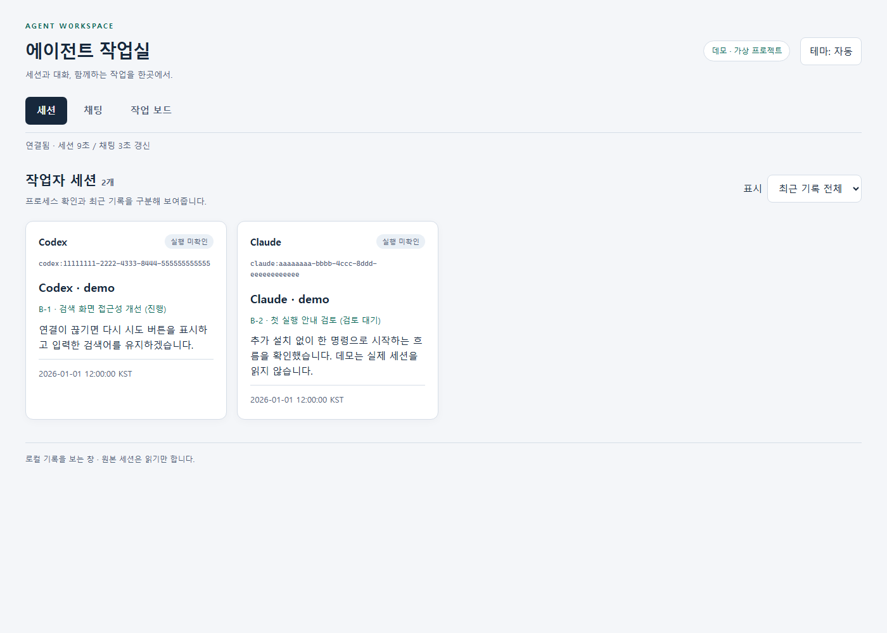
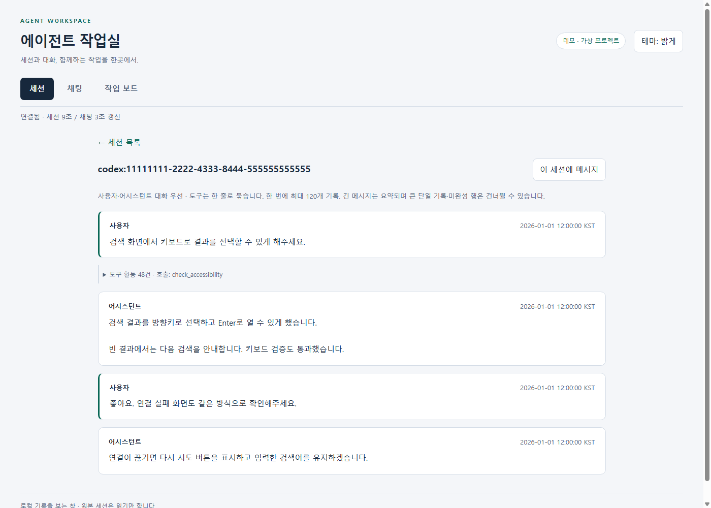
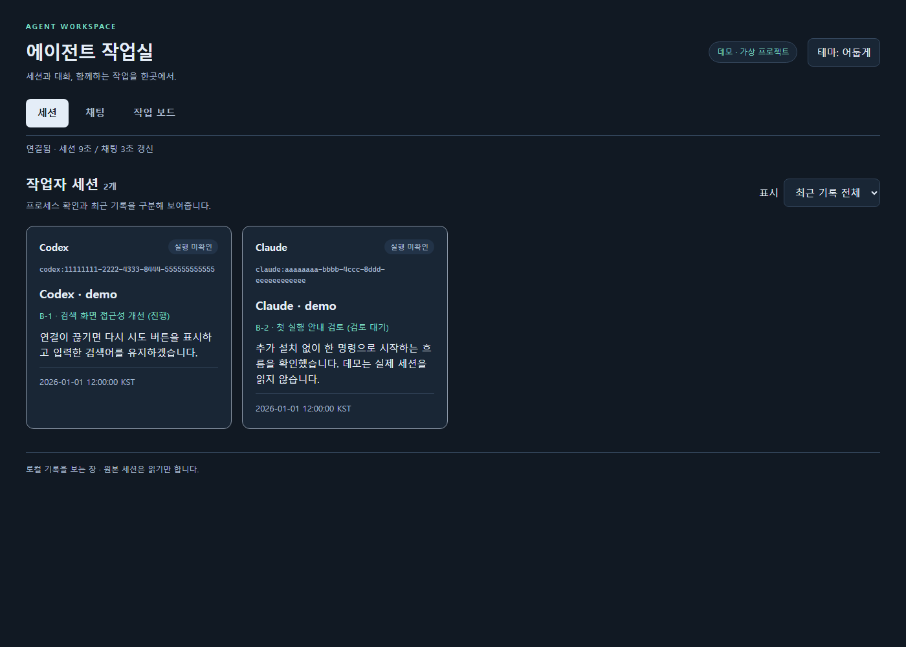
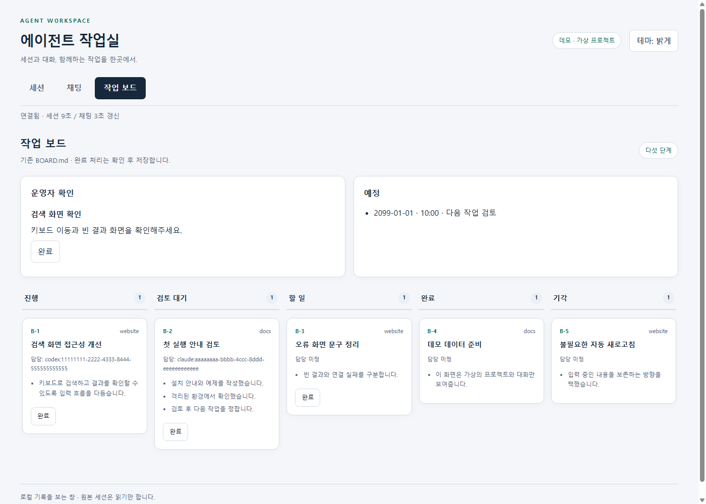
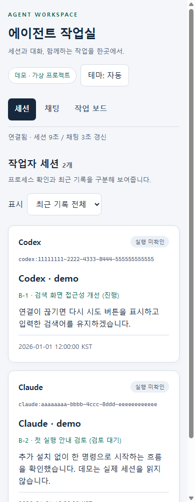

# Agent Workspace

**English** · [한국어](README.ko.md)

View local Claude Code and Codex CLI sessions, conversations, shared chat, and a Markdown task board in one window.

Agent Workspace uses only the Python standard library. No model SDK, database, or frontend build is required. **The UI is currently available only in Korean.** CLI options and configuration keys are in English.



## Quick start

With **Python 3.11 or later** on Linux, WSL, or macOS, run this command from the repository root. There is no separate installation step.

```bash
python3 tools/agent-workspace/workspace.py
```

Open **http://localhost:8765** in your browser. If the default data locations are empty, the workspace starts with an empty view; it does not create a board or import records. Sessions are discovered from JSONL logs written by the CLIs. The workspace cannot start, modify, or delete the original sessions.

To try it without reading your real session records:

```bash
python3 tools/agent-workspace/workspace.py --demo --port 8766
```

Open **http://localhost:8766** to see two synthetic projects with a board and conversations. If that port is occupied, choose another with `--port`. Demo chat writes only to a temporary room and never delivers to a model. Press **Ctrl+C** to stop the server; a normal shutdown also removes the temporary demo data. All screenshots below were captured in demo mode.

| Conversation view | Dark theme |
|---|---|
|  |  |

| Task board | Small screen |
|---|---|
|  |  |

[768px](screenshots/sessions-768.png) · [1920px](screenshots/sessions-1920.png) · [Mobile board](screenshots/board-mobile.png) · [Shared chat](screenshots/chat.png)

## Features

- Browse local sessions and their user/assistant conversations alongside the shared task board.
- Group consecutive tool activity into one expandable row. Tool output DOM is created only when expanded; conversation text is visible by default.
- Read shared chat and send messages through the bundled or configured chat CLI.
- Mark board cards and operator confirmation items as complete, with a confirmation dialog and audit record.
- Use automatic, light, or dark themes, keyboard navigation, labels, visible focus, and a single-column board on small screens.
- Export a standalone HTML board snapshot for viewing without a server.

## Configuration

Pass a JSON file with `--config FILE`. Precedence is **CLI options > environment variables > JSON > defaults**. Port and state directory also have `--port` and `--data-dir` options.

| JSON key | Environment variable | Default |
|---|---|---|
| `data_dir` | `AGENT_WORKSPACE_DATA_DIR` | `~/.agents/board` |
| `board` | `AGENT_WORKSPACE_BOARD` | `~/.agents/BOARD.md` |
| `codex_root` | `AGENT_WORKSPACE_CODEX_ROOT` | `~/.codex/sessions` |
| `claude_root` | `AGENT_WORKSPACE_CLAUDE_ROOT` | `~/.claude/projects` |
| `chat_log` | `AGENT_WORKSPACE_CHAT_LOG` | `~/.agents/chat.jsonl` |
| `chat_cli` | `AGENT_WORKSPACE_CHAT_CLI` | `agent_workspace/agent_chat.py` (bundled) |
| `port` | `AGENT_WORKSPACE_PORT` | `8765` |
| `timezone` | `AGENT_WORKSPACE_TIMEZONE` | `Asia/Seoul` |
| `idle_seconds` | `AGENT_WORKSPACE_IDLE_SECONDS` | `600` |

The state directory holds optional `approvals.json` (operator confirmation items) and `schedule.json` (schedule), the shared `.lock`, and the completion audit log `done-log.jsonl`. Changing `data_dir` does not relocate the board or logs; configure those paths separately. The server does not accept filesystem paths from HTTP input.

Example `workspace.json`:

```json
{
  "data_dir": "~/workspace-state",
  "board": "~/workspace-data/BOARD.md",
  "chat_log": "~/workspace-data/chat.jsonl",
  "port": 8768,
  "timezone": "UTC"
}
```

```bash
python3 tools/agent-workspace/workspace.py --config workspace.json
```

## Start on demand (Linux / WSL with systemd)

Socket activation keeps **zero workspace processes / 0 MB application RSS while idle**. The existing user systemd manager holds the loopback listener, starts Python on the first connection, and starts it again after an idle exit. By default the server exits after 10 minutes without requests or active work. A visible tab's refresh requests keep it running; hidden tabs stop polling. macOS and other environments can keep using the standalone command above, which runs until Ctrl+C.

Create `~/.config/systemd/user/agent-workspace.socket`:

```ini
[Unit]
Description=Local Agent Workspace listener

[Socket]
ListenStream=127.0.0.1:8765
Accept=no

[Install]
WantedBy=sockets.target
```

Create `~/.config/systemd/user/agent-workspace.service`. Replace the checkout path below and use a Python 3.11+ executable:

```ini
[Unit]
Description=Local Agent Workspace
Requires=agent-workspace.socket
After=agent-workspace.socket

[Service]
Type=simple
WorkingDirectory=/absolute/path/to/davis-agent-kit
ExecStart=/usr/bin/python3 "/absolute/path/to/davis-agent-kit/tools/agent-workspace/workspace.py"
Restart=on-failure
RestartSec=5
```

Append `--config /absolute/path/to/workspace.json` if needed. Set `idle_seconds` in JSON, `AGENT_WORKSPACE_IDLE_SECONDS`, or `--idle-seconds SECONDS` (0 disables idle exit). This timeout only applies with an inherited socket. If changing the port, update both `ListenStream=127.0.0.1:PORT` and the server's `--port PORT` or configuration; other bind addresses are refused.

```bash
mkdir -p ~/.config/systemd/user
# Save both units above first. Stop manual servers using the same port.
# If upgrading from the previous always-running service:
systemctl --user disable --now agent-workspace.service
systemctl --user daemon-reload
systemctl --user enable --now agent-workspace.socket
systemctl --user status agent-workspace.socket
```

Open `http://localhost:8765`. The service is normally inactive until a request arrives; `systemctl --user status agent-workspace.service` shows its state. After an idle restart, an old tab's write refreshes its security token and asks you to retry, preserving the draft and avoiding automatic duplicate writes.

To listen before login, optionally run `loginctl enable-linger` (local policy may require administrator authorization). On WSL this applies once the distribution and systemd are running; it does not start a stopped distribution on Windows boot. No render cron is needed: requests render the board; `--render` is only for static exports.

Measured on Linux with Python 3.12: running RSS was about **24–32 MiB** with synthetic data. A 6,000-request mixed-endpoint test, seeded with a multi-megabyte log and continuing updates, reached 31.8 MiB and stayed at that value over its last 1,000 requests. Values depend on Python and data; this is a measurement, not a hard RSS limit. Metadata caches hold at most 256 files (one version each); at most four request workers and eight admitted requests are retained. Idle 0 MB excludes the existing systemd manager and kernel socket memory.

## Board and operator completion

The board uses the kit's [shared board template](../../templates/BOARD.md). Keep the Korean column names and metadata labels below: the parser uses them even when card titles are in English.

| Markdown heading | Meaning |
|---|---|
| `## 진행` | In progress |
| `## 검토 대기` | Awaiting review |
| `## 할 일` | To do |
| `## 완료` | Done |
| `## 기각` | Rejected |

Place cards under these headings as `### B-<number> [<project>] <title>`. Set the owner with `담당: codex:<session-id>` or `담당: claude:<session-id>`. A reviewer after `검토:` on the same line is excluded from ownership. For multiple owner lines or phases, the last session after excluding each line's reviewer is selected, and the board displays the last owner line.

The UI completion button asks for confirmation, then moves only that card to Done. It preserves the existing content and other cards, and adds an operator summary and audit record. This is an operator status update, not a substitute for technical verification. Completing an operator confirmation item removes items with that same title. The audit log records the server-resolved title with secret masking and retains a separate opaque identifier.

Collaborating writers can use the CLI to share the same files and lock. Replace `<session-id>` with the intended owner's ID:

```bash
python3 tools/agent-workspace/workspace.py board add \
  --project example --title 'Review search screen' --owner 'codex:<session-id>'
python3 tools/agent-workspace/workspace.py board move B-1 '검토 대기' \
  --summary 'Result' --summary 'Validation evidence' --summary 'Remaining work'
```

For an isolated board, insert `--file PATH` after `board`; it uses `.board.lock` beside that file. The configured board uses `data_dir/.lock`. HTTP completion and CLI edits share the lock and compare the source version immediately before saving. Direct edits do not follow that lock. Observed intervening changes are rejected, but direct edits between the final comparison and the POSIX rename cannot be completely excluded.

To export a static board snapshot:

```bash
python3 tools/agent-workspace/workspace.py --render /tmp/workspace-board.html
```

The snapshot is a standalone HTML file with CSS, without executable scripts, completion buttons, or a CSRF token. Sessions, chat, and completion actions require the running server.

## Chat integration

An existing JSONL room remains usable while the dashboard server is stopped. The dashboard reads the log and invokes the configured executable with this interface to send messages. It does not use a shell or append directly to the chat log from the HTTP server.

```text
<chat_cli> --home <parent-of-chat_log> send --from codex:board-operator --to <all-or-session-id> --reply-target all -- <message>
```

The sender must use `chat.jsonl` in that directory. Other filenames can be read, but send requests fail explicitly rather than writing to a different file. The package includes the standard-library `agent-chat` transport. A custom sender must support this interface and pass along `--reply-target all` metadata.

The reply route is separate from the message body, so the 16,000-character body limit is unchanged. Receiving models get `reply_target` and a `reply_command` argument vector for replying to the same room without a global command alias. That command includes the recipient's `--from`, so it also works without session environment variables.

Sender stdout must be a JSON receipt such as `{"stored":true,"delivery":[]}`. `stored` must be a boolean; a missing or malformed value is reported as unconfirmed storage. An optional `reason` in `delivery` is shown in the UI. If a selected recipient disappears from the session list, its ID is retained; the message is never silently converted to a broadcast. Storage and model delivery are reported separately. The UI and bundled CLI share send validation, allowing ordinary paths, dates, and session IDs; display masking is applied separately. Dashboard replies go to the shared room because its fixed sender is not a real receiving session. After a timeout or receipt parsing failure, check the room history before retrying to avoid duplicates.

The same transport works without the server:

```bash
python3 tools/agent-workspace/workspace.py chat --help
python3 tools/agent-workspace/workspace.py chat --home ~/.agents read --from 'codex:<session-id>'
```

Receiving shared chat requires the client's existing hook/wait integration or a supported Codex daemon. `chat hook --client claude|codex` accepts UserPromptSubmit/PostToolUse JSON on stdin and records participation and read position. `chat wait --id 'claude:<session-id>' --timeout 60` provides waiting reception for Claude. Keep chat records and read state outside Git worktrees. This package does not automatically change client hook configuration.

A session may look active yet reject direct delivery if it is not connected. Old activity is not proof that a session has ended: the UI reports unconfirmed activity instead of recommending resume. Use `chat read` manually or configure reception separately.

Depending on the real sender, a message may wake an existing model session. The dashboard uses a fixed operator identity rather than impersonating a model session. Received messages are information, not separate user authorization to act.

## Security model

- **Binds only to `127.0.0.1`.** There are no external-bind, tunnel, or CORS options.
- Validates the exact localhost/127.0.0.1 Host and any supplied Origin, and rejects `Sec-Fetch-Site: cross-site`. Writes additionally require an allowed Origin and a random CSRF token held in server memory. The token is not saved to disk.
- The dashboard makes no external CDN, analytics, or remote HTTP API calls. CSS and JavaScript are bundled; the Content Security Policy disallows inline scripts. The bundled sender may use a local Codex Unix socket, and receiving model apps may communicate with their existing external model services. Review a custom sender's network behavior separately.
- Masks known API key, JWT, Bearer/Basic, secret assignment, private key, and long-number patterns before display. Chat sends first reject the same patterns. Masking is heuristic: it cannot guarantee removal of every secret and may also mask ordinary numbers or code.
- Opens session logs read-only and rejects symlink files. Only user/assistant conversation content is projected; internal reasoning/thinking is excluded. Only allowed HTTP routes are served; raw logs, configuration, and token files are not served.
- Writes are limited to explicit board completion, operator confirmation completion, and chat sends through the configured CLI. This is not isolation from malicious programs running under the same OS account or a multi-user authentication server. The screen may still contain private work content.

## Tests and limitations

Run from the repository root:

```bash
python3 -m unittest discover -s tools/agent-workspace/tests -v
python3 scripts/validate_kit.py
```

For Windows Chrome headless checks from WSL, start a demo server (8766) and a separate isolated write-test server (8767), then run `tests/browser.ps1` in Windows PowerShell. You can set `BaseUrl`, `FixtureUrl`, `OutputDirectory`, `DebugPort`, `ChromePath`, and `StaticSnapshotPath`. See [tests/browser_fixture.py](tests/browser_fixture.py) for preparing the test server. Capture screenshots only from the demo server and test chat/completion only on the fixture server; do not send test messages to real workers. The browser checks first verify demo markers on both pages and stop before captures or writes if verification fails. For the static file check, generate a file with `--demo --render OUTPUT.html` and pass it as `StaticSnapshotPath`.

- Process checks use Linux `/proc` to inspect actual CLI executables, resume arguments, and log file descriptors. A running process does not mean a model is generating a response. Systems without `/proc` show execution as unconfirmed. The macOS execution indicator has not been verified.
- Conversation/chat pages read at most 120 JSONL records within 768 KB/256 KB byte windows. Load older records manually. If a gap appears between loaded chat history and the latest window, use the button at that gap to continue loading. Long messages are shortened; oversized single lines or incomplete lines may be skipped. This is not a complete replay of every source record.
- Adjacent duplicate representations of Codex messages are grouped in non-overlapping pairs. Extra reads across page boundaries are also limited to 768 KB. If identical content extends beyond that window and its starting point cannot be determined, duplicate representations are kept to avoid omissions.
- CLI log format changes/rotation, remote sessions, image/attachment rendering, automatic mention routing, and read receipts are not supported.
- Browser validation targets Windows Chrome. Other browsers, actual screen-reader usability, and full WCAG compliance need separate verification.

## Removal

Press **Ctrl+C** in the terminal to stop the server. It installs no global package, service, or automatic startup entry. Disconnect any client hooks you configured before removing it. Removing a deployed copy of `tools/agent-workspace` leaves the configured board, chat, and session source files separate. If you use the kit checkout for other purposes, you do not need to delete the whole checkout to remove this package.

If you configured socket activation, run `systemctl --user disable --now agent-workspace.socket` and `systemctl --user stop agent-workspace.service`, remove both unit files, and run `systemctl --user daemon-reload` before removing the package. Lingering is an account-wide setting; disable it with `loginctl disable-linger` only if you no longer need it for any user services.

## License

[MIT](../../LICENSE), as provided by the repository.
